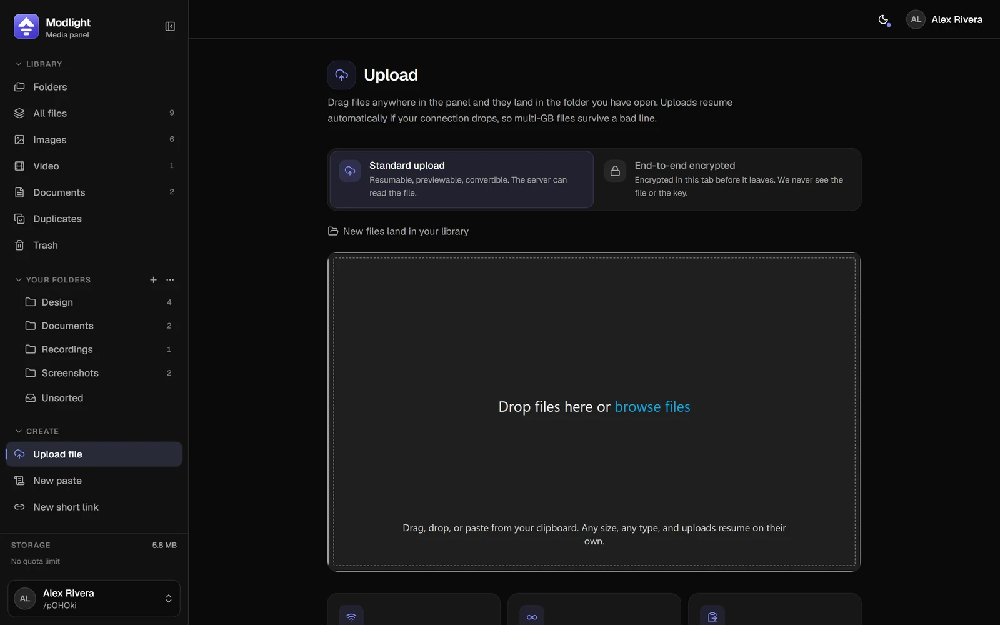
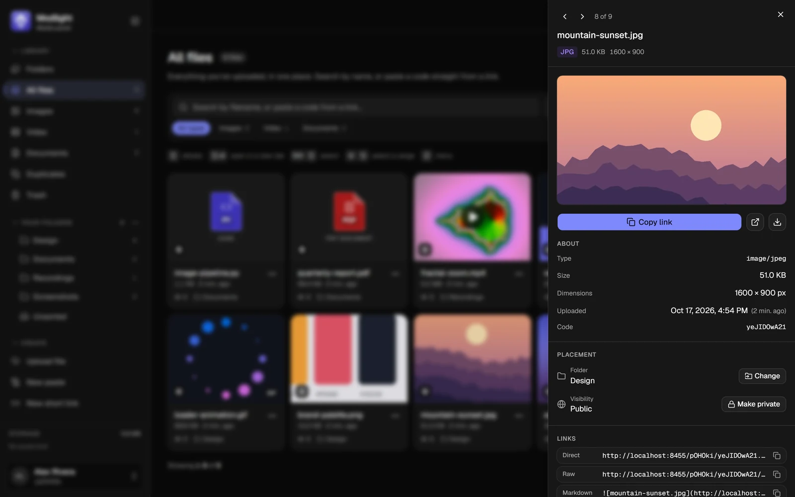
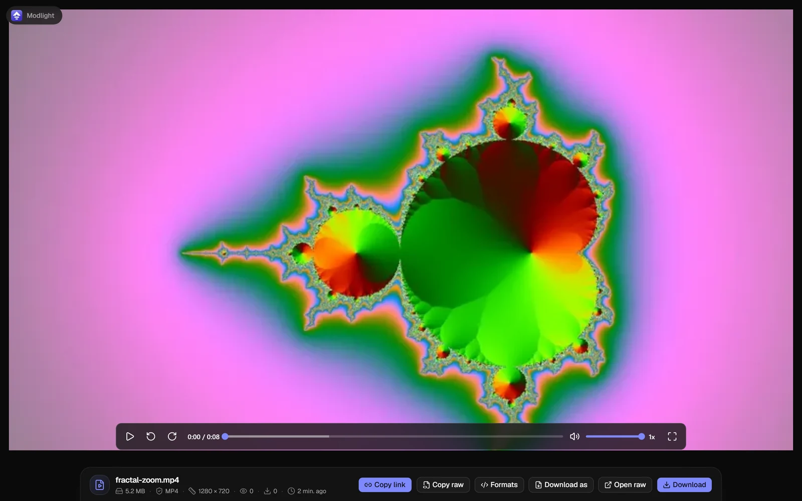
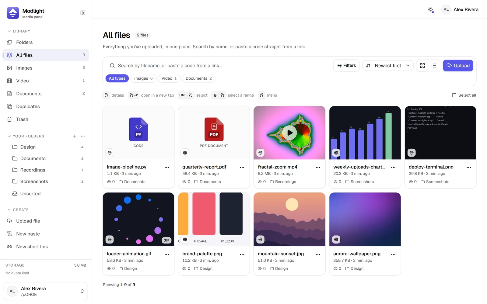
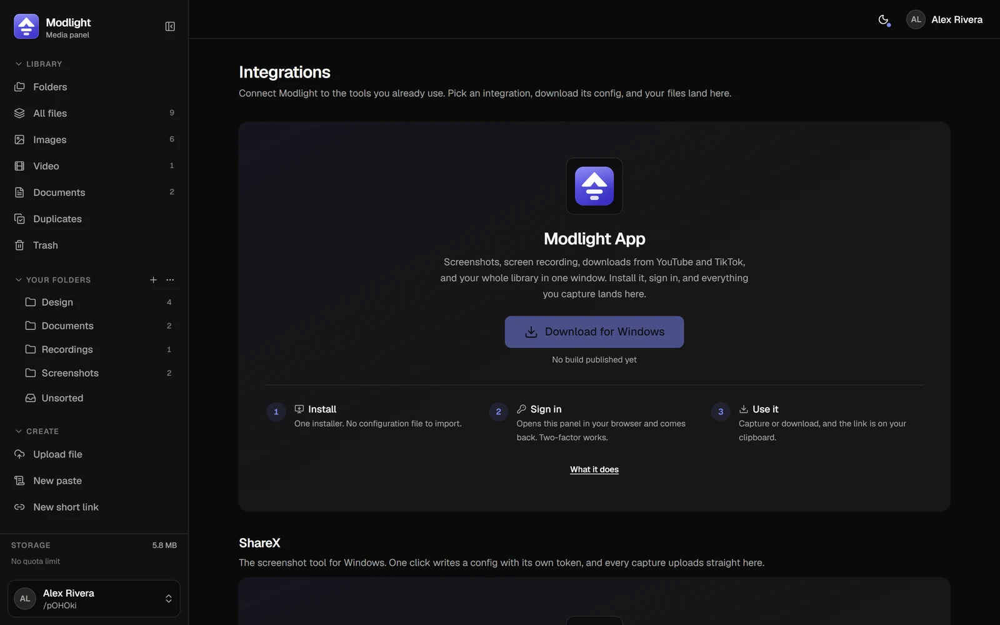
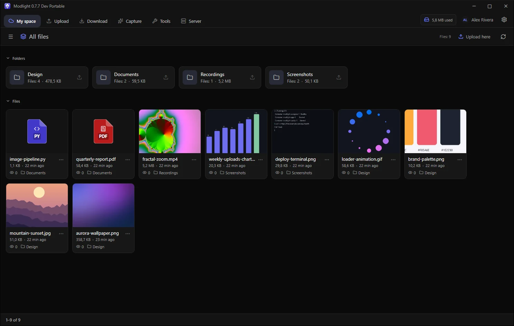

<div align="center">


# Modlight

**A self-hosted file and screenshot host that does not drop big uploads.**

Upload, organise and share files, screenshots, videos and pastes on your own server.<br>
Resumable uploads, a fast web panel, and a ShareX-compatible API.

[](LICENSE)


**Looking for the Windows app?** → **[Modlight App](https://github.com/Nimfek/Modlight-App)**:
capture, upload and browse this server from your desktop.

</div>

<p align="center">
  
</p>

---

## What it is

Modlight is the server half of a personal file host. You run it on a VPS or a home server,
point a domain at it, and get:

- **a web panel** where you drop files, paste screenshots, organise everything in folders
  and copy a link in whatever format the place you are pasting into expects;
- **public file pages** that preview images, video, audio, code and documents, and unfurl
  properly in Discord, Telegram, Slack and anything else that reads OpenGraph;
- **an API** that ShareX, your scripts and [Modlight App](https://github.com/Nimfek/Modlight-App)
  upload to.

It was written for the one thing small file hosts tend to get wrong: **uploading a large
file over a bad connection** without buffering it whole or starting from zero when the
link drops.

## Highlights

<table>
<tr>
<td width="50%" valign="top">

**Uploads that survive**
- Resumable, chunked uploads from the browser ([tus](https://tus.io)): a dropped
  connection resumes from the last confirmed byte, not from zero.
- Streaming single-request uploads for ShareX: nothing is buffered in memory and there is
  no size cap unless you set one.
- Drag files anywhere in the panel, paste from the clipboard, or encrypt in the browser
  before uploading: end-to-end, with the key in the link's fragment, which never reaches
  the server.

</td>
<td width="50%" valign="top">



</td>
</tr>
<tr>
<td width="50%" valign="top">



</td>
<td width="50%" valign="top">

**Sharing on your terms**
- Every link format one click away: page, direct, Markdown, BBCode, HTML.
- Expiring links, view limits, one-time links and per-file passwords.
- A URL shortener with custom names, passwords and expiry, optionally on its own domain.
- Rich previews in chat apps, through OpenGraph and oEmbed.

</td>
</tr>
<tr>
<td width="50%" valign="top">

**Media, done properly**
- Thumbnails for images, animated previews for GIFs and videos, scrub previews on the timeline.
- A real video and audio player that follows your theme.
- Syntax-highlighted code and pastes; HTML renders in a sandbox, never on your origin.
- "Download as…" between image, video and audio formats, and a one-click web-playable
  copy of recordings that would otherwise stutter.

</td>
<td width="50%" valign="top">



</td>
</tr>
<tr>
<td width="50%" valign="top">



</td>
<td width="50%" valign="top">

**Yours to run**
- Folders, a trash with restore, bulk actions, duplicate detection.
- Scoped API tokens, revocable sessions and devices, two-factor authentication.
- 14 themes in light and dark, custom wallpaper and avatar, English and Polish.
- Admin panel: accounts and quotas, disk usage, mail, registration control.
- Local disk or any S3-compatible storage. One Docker Compose stack.

</td>
</tr>
</table>

---

## Install

You need a Linux server with **Docker** (including the Compose plugin) and a domain whose
DNS record points at that server.

```bash
git clone https://github.com/Nimfek/Modlight.git
cd Modlight
./setup.sh
```

`setup.sh` asks a few questions and writes `.env`:

| Step | What it asks |
|---|---|
| **Address** | your domain, optional extra domains, an optional short-link domain, the panel's name |
| **HTTPS** | the built-in Caddy (automatic certificates, needs ports 80 and 443) **or** your own reverse proxy (nginx, Traefik, aaPanel…), for which it writes a ready nginx block |
| **Storage** | this server's disk (a Docker volume or any directory, such as a dedicated disk) **or** S3-compatible storage |
| **Accounts** | open or closed registration, the largest upload, the default quota |
| **E-mail** | SMTP for password resets and invitations, or skip it and set it up later in the panel |

It generates every secret itself, shows a summary, and offers to build and start the stack.
When it is up, open `https://your-domain/register`: **the first account becomes the
administrator.** Nobody else can register unless you opened registration.

Prefer to do it by hand? Every variable is described in [`.env.example`](.env.example), and
the [deployment guide](docs/deployment.md) walks through the same steps manually. For an
unattended install, answer the questions with environment variables:

```bash
DOMAIN=files.example.com PROXY=caddy START=yes ./setup.sh --yes
```

### Day two

```bash
git pull && docker compose up -d --build     # upgrade; database migrations run on start
./setup.sh                                   # change settings; your secrets are kept
docker compose logs -f app                   # logs
```

Backups, reverse-proxy details and the settings that decide whether large uploads work are
in the [deployment guide](docs/deployment.md).

---

## Connect your tools



- **[Modlight App](https://github.com/Nimfek/Modlight-App)** for Windows: screenshots,
  screen recording, video downloads and your whole library in one window. Install it, type
  your server's address, sign in through the browser.
- **ShareX**: open **Integrations** in the panel and click the ShareX button. It creates a
  token and downloads a ready `.sxcu` file. The contract is in [`docs/sharex-setup.md`](docs/sharex-setup.md).
- **Anything that can send an HTTP request**: `POST /upload` with an API token. See [API](#api).

<p align="center">
  
  <br><sub>The same library in <a href="https://github.com/Nimfek/Modlight-App">Modlight App</a>.</sub>
</p>

---

## API

Every endpoint accepts an API token as an `x-api-key` header or `Authorization: Bearer <token>`.
Tokens are created in the panel with one of four scopes:

| Scope | Can |
|---|---|
| `upload` | Upload files, nothing else. What ShareX needs. |
| `read` | List and read files, folders and links, including unpublished ones. |
| `write` | Everything `read` can, plus change and delete. What Modlight App uses. |
| `full` | Everything, including administrative endpoints. |

```bash
curl -H "x-api-key: $TOKEN" -F "upload=@screenshot.png" https://files.example.com/upload
```

Main routes: `GET /api/me`, `GET|PATCH|DELETE /api/uploads`, `GET|POST|PATCH|DELETE /api/folders`,
`GET|POST /api/shortlinks`, `GET /api/link-info?url=…`, `GET|PUT /api/client-settings`,
`GET /api/releases/app`. A missing scope is a `403` that names the scope the call needed.

---

## Development

```bash
pnpm install
docker compose up -d        # a development PostgreSQL on localhost:5433
cp .env.example .env        # the defaults work for local development
pnpm db:migrate
pnpm dev                    # http://localhost:8420
```

Checks: `pnpm typecheck`, `pnpm test`, `pnpm build`. The stack, the custom server and every
script are described in [`docs/development.md`](docs/development.md).

## Documentation

- [Deployment](docs/deployment.md): production, reverse proxies, storage, upgrades, backups
- [Features](docs/features.md): what the panel can do
- [ShareX setup](docs/sharex-setup.md): the ShareX upload contract
- [Development](docs/development.md): stack, architecture, scripts, publishing app releases

## Security

Please report vulnerabilities privately, as described in [`SECURITY.md`](SECURITY.md). Do not
open a public issue for anything that could be exploited.

## License

[GNU Affero General Public License v3.0](LICENSE). If you run a modified version as a
service for other people, you must offer them its source code.

The Windows client, [Modlight App](https://github.com/Nimfek/Modlight-App), is a fork of
ShareX and lives in its own repository under the GPL-3.0.

## Credits

- [tus](https://tus.io), [Uppy](https://uppy.io), [sharp](https://sharp.pixelplumbing.com),
  [FFmpeg](https://ffmpeg.org), [media-chrome](https://github.com/muxinc/media-chrome),
  [Better Auth](https://www.better-auth.com), [Drizzle](https://orm.drizzle.team),
  [shadcn/ui](https://ui.shadcn.com) and the rest of the open-source stack it is built on.
